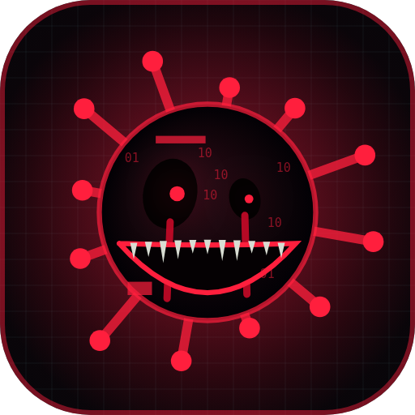
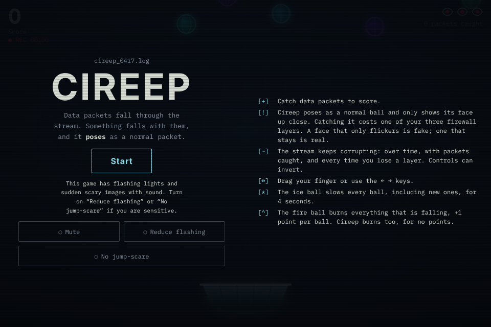
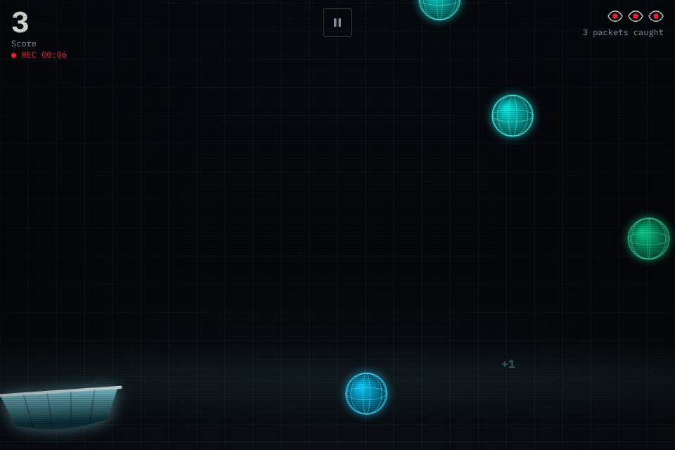

# CIREEP

A horror mini game that runs in the browser (HTML5 Canvas, no engine and no outside library).
Catch the data packets to score, and avoid **Cireep**: it poses as a normal ball and only shows its face up close.

The game has a reduce-flashing mode, a no-jump-scare mode, can be installed as an app, and works offline.

  
 <h1 align="center">CIREEP</h1> 
 A short horror mini game for the browser.  Catch the data packets. Avoid <b>Cireep</b>. 
 
 <a href="https://dasznaq.itch.io/cireep"><b>▶ Play on itch.io</b></a> 
 
   

About

Data packets fall through the stream. Something falls with them, and it poses as a normal packet. Cireep only shows its face up close. Catching it costs one of your three firewall layers.

Made with plain HTML5 Canvas, no engine and no outside library
All music and sounds are made by code (Web Audio)
Works on desktop and mobile, with a reduce-flashing mode and a no-jump-scare mode
Controls
Desktop: ← → keys
Mobile: drag your finger
Warning

# This is open source
I'm releasing all my code in here, so if you wanna remix this game, you can get it, But if possible, I would like my name to appear in the game's end credits.

This game has flashing lights and sudden scary images with sound. Turn on Reduce flashing or No jump-scare in the menu if you are sensitive.

# THANK YOU